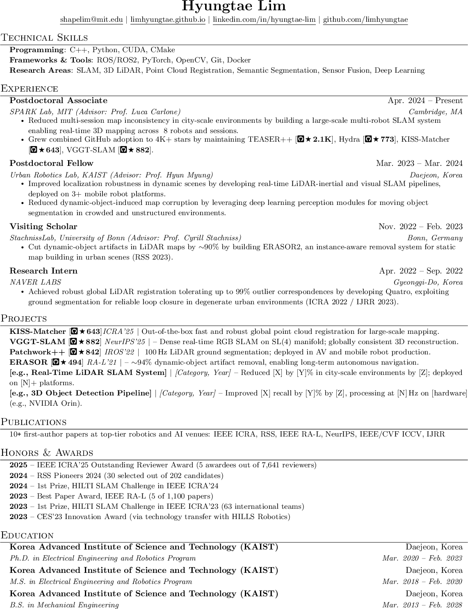
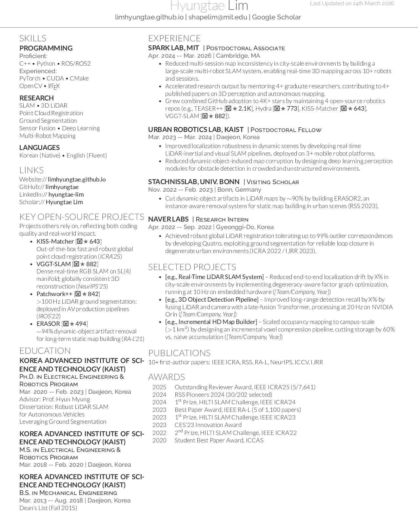
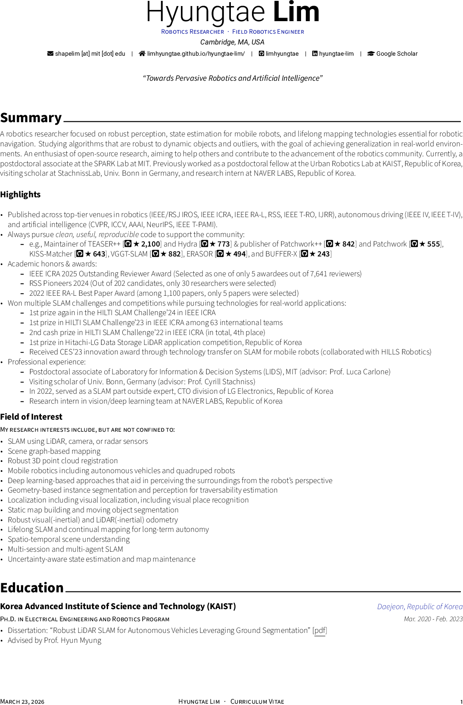

# Awesome-PhD-CV

A copy of the "Awesome Ph.D. CV Templates" collection by [Hyungtae Lim](https://limhyungtae.github.io/hyungtae-lim/): three LaTeX CV and resume templates for PhD students and researchers, from an ATS-safe industry resume to a full academic CV.

The templates, the sample content in them and the guide are Hyungtae Lim's work. Everything sits in [`Awesome-PhD-CV-main/`](Awesome-PhD-CV-main/); see the original [README](Awesome-PhD-CV-main/README.md) there for the full write-up.

| Jake's format | Deedy format | Awesome-CV format |
|---|---|---|
|  |  |  |

## Templates

| Folder | Use | Pages | Columns | Engine |
|---|---|---|---|---|
| `Awesome-PhD-CV-main/jakes-format/` | Industry and internship applications, ATS-safe | 1 | 1 | pdfLaTeX |
| `Awesome-PhD-CV-main/deedy-format/` | Dense industry resume | 1 | 2 | XeLaTeX |
| `Awesome-PhD-CV-main/research-cv/` | Academic CV (faculty, postdoc, PhD applications) | Multi-page | 1 | XeLaTeX |

## Repository layout

```
Awesome-PhD-CV-main/
├── README.md               # original README
├── GUIDELINES.md           # guide: converting an academic CV into an industry resume
├── generate_previews.sh    # rebuilds assets/*.png from the three PDFs (needs ImageMagick 7)
├── assets/                 # preview images
├── jakes-format/           # resume.tex, resume.pdf
├── deedy-format/           # resume.tex, resume.pdf, deedy-resume-openfont.cls, fonts/
└── research-cv/            # cv.tex, cv.pdf, awesome-cv.cls, cv/ (one .tex file per section), src/
```

## Build

You need a LaTeX distribution with `pdflatex` and `xelatex`.

```bash
cd Awesome-PhD-CV-main

cd jakes-format && pdflatex resume.tex && cd ..
cd deedy-format && xelatex resume.tex && cd ..
cd research-cv  && xelatex cv.tex     && cd ..
```

Regenerate the preview images after a rebuild:

```bash
./generate_previews.sh
```

## Making it yours

- Replace the sample name, contact details and entries in each `.tex` file.
- In `research-cv/`, edit the section files under `cv/`. `cv.tex` picks sections with `\input{cv/<section>}` lines; comment a line out to drop that section.
- Read [`GUIDELINES.md`](Awesome-PhD-CV-main/GUIDELINES.md) before turning an academic CV into an industry resume.

## License

There is no LICENSE file in this repository. The original README lists the license of each template:

- Awesome-CV: [CC BY-SA 4.0](https://creativecommons.org/licenses/by-sa/4.0/) (original by Claud D. Park)
- Jake's Resume: [MIT License](https://opensource.org/licenses/MIT) (original by Jake Gutierrez, based on [sb2nov/resume](https://github.com/sb2nov/resume))
- Deedy Resume: [Apache 2.0](https://www.apache.org/licenses/LICENSE-2.0) (original by Debarghya Das)
